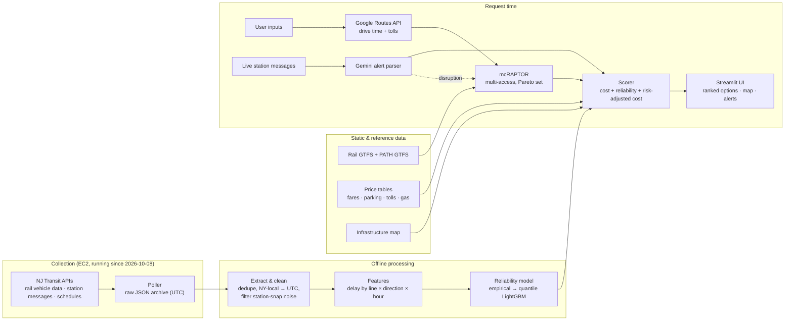

# Crossing — Project Brief

*Working title. HackRU, Fall 2026. Solo build. Author: Villain.*

> **A reliability-aware, total-cost trip chooser for getting from New Jersey into New York.**
> It answers the question every NJ commuter asks and no app answers: *"Given where I am, when I'm leaving, and what's at stake, which station, which train, and which route actually make sense right now — and what's the real price, including the risk of being late?"*

---

## 1. Concept

### The problem

Commuting from New Jersey into New York is a decision with hidden costs:

- **Where to board.** Chatham, Summit, Secaucus, Newark, Hoboken: each has different parking costs, train frequency, fares, and driving times.
- **What it really costs.** Fare + parking + tolls + gas, and for some, the option of driving all the way in (tunnel tolls, Manhattan parking, congestion pricing). No tool totals this.
- **How reliable it is.** Delays into and out of New York are common, and a late train is not just lost time: it means extra parking hours, missed connections, rideshares to recover, or a missed shift.
- **What it depends on.** Trips into New York Penn run through a few aging bottlenecks (the Portal Bridge, the North River tunnels, Penn Station). When one fails, the whole corridor fails. Some routes (e.g. Hoboken + PATH) avoid them entirely; riders rarely know which.

Existing tools (the NJ Transit app, Google Maps) optimize **scheduled time**. They don't price parking, they don't measure reliability, and they don't show exposure to fragile infrastructure.

### The thesis

> For many trips into New York, transit already beats driving on total cost. What holds people back is **uncertainty**: riders can't see the real cost, and they can't trust the schedule. Make the cost visible and the risk measurable, and transit becomes the obvious choice. NJ Transit should treat reliability as a cost that riders pay, and show them the bill.

### Origin

Built from a real, personal decision: the author's own trips from Chatham to New York, and the recurring question of whether Secaucus or another station is the better choice on a given weekday.

### Japan precedent → NJ Transit

- **Precedent:** Japanese route apps (Yahoo! Norikae Annai, Navitime, Jorudan) have long ranked trips by time, fare, and transfers across competing operators, on top of open data efforts like ODPT.
- **Transfer:** NJ Transit riders have no equivalent. This project brings that multi-criteria approach to a **car-dependent** commuter system, where the access choice (where to drive and park) is part of the trip.
- **Contribution back:** neither ecosystem ranks routes by **measured reliability**. That layer is transferable to Japan, including regional park-and-ride and areas with shrinking bus service (交通空白).
- **Proof of transferability:** the routing engine (mcRAPTOR) was previously built for Tokyo's network in *Tetsudle*. Same engine, two networks.

---

## 2. Users and core question

**Primary user:** a New Jersey resident traveling into Manhattan by car + rail, rail + PATH, or car only. Occasional riders and monthly-pass commuters alike.

**Inputs**
- Origin (home address or current location)
- Destination (e.g. Penn Station area, Midtown, Downtown/WTC)
- Departure time, or "arrive by" deadline
- Personal settings: car mpg, fare type (one-way / off-peak / weekly / monthly), **cost of being late** (value of time, or "hard deadline")

**Output: a ranked comparison of options**, each showing:
- Expected arrival and **probability of arriving by the deadline**
- Total cost, itemized: fare · parking · tolls · fuel
- **Risk-adjusted cost** (base cost + expected cost of delay)
- **Infrastructure exposure** (depends on Portal Bridge / North River tunnels / Penn Station?)
- Active alerts affecting the option, and the backup plan if it fails

---

## 3. Functionality

| # | Feature | What it does | Tier |
|---|---|---|---|
| F1 | **Total-cost comparison** | Itemized fare + parking + tolls + fuel for each option | Core |
| F2 | **Reliability score** | Probability of on-time arrival, from historical delay data | Core |
| F3 | **Multi-criteria routing** | mcRAPTOR over NJ Transit rail + PATH with multiple driving-access stations; returns a Pareto set (fastest / cheapest / fewest transfers) | Engine |
| F4 | **Risk-adjusted cost** | Converts delay risk into dollars, using the user's cost of being late | Core+ |
| F5 | **Alert awareness** | Gemini parses live station messages into structured disruptions and flags affected options | Module |
| F6 | **Infrastructure exposure** | Labels options that depend on the Portal Bridge, North River tunnels, or Penn Station | Module |
| F7 | **Backup routing** | When a disruption is detected, removes the affected links and reroutes, showing the best alternative and its cost | Stretch |
| F8 | **Quantile delay model** | Predicts the delay *distribution* for each candidate train, evaluated against baselines | Stretch |
| F9 | **Drive-all-the-way baseline** | Compares against driving into Manhattan (tolls, parking, congestion pricing) | Stretch |

---

## 4. Implementation

### F1 — Total-cost engine
- **Fares:** hand-collected origin–destination table (NJ Transit rail GTFS has no fare files), plus PATH's flat fare. Supports one-way, off-peak, weekly, monthly.
- **Parking:** hand-collected per-lot table (`daily_rate`, `permit_only`, `operator`), so permit-only lots are excluded.
- **Tolls:** Google Maps Routes API toll estimates; fallback to a small hand-collected table.
- **Fuel:** `miles ÷ mpg × price` (AAA NJ average; mpg is a user setting). Optional "true cost of driving" mode using the IRS mileage rate.
- Every price table carries `source_url` and `checked_date`, because fares and prices change.

### F2 / F8 — Reliability model
- **Data:** the author's own archive of NJ Transit rail `getVehicleData` (`SEC_LATE`, polled every 30s since 2026-10-08), joined to rail GTFS on train number (`trip_short_name`, ~86% match) plus service date.
- **Known data properties:** delays are smooth and complete; positions are snapped to stations, so the model works **stop by stop**, not along the track; timestamps are New York local time without a zone marker.
- **v0 (hackathon core):** empirical delay distributions pooled by line × direction × hour, since only about one weekday of data exists at build time.
- **v1 (stretch):** quantile regression (LightGBM, quantile loss) predicting delay at the boarding and destination stations from current delay, line, direction, hour, and weather.
- **Baselines (always reported):** (a) the schedule ("on time"), (b) persistence ("current delay carries forward").
- **Evaluation:** time-based split. Data collected *during* the hackathon is the held-out test set.
- **On-time probability:** combine train-delay distribution, drive-time uncertainty, and transfer slack (Monte Carlo sampling is simple and explainable).

### F3 — mcRAPTOR routing engine
- **Network:** NJ Transit rail GTFS + PATH GTFS for the service day.
- **Access legs:** driving from origin to each candidate station via Google Routes API (traffic-aware), entered as multiple source stops with different arrival times and costs.
- **Criteria (deterministic):** arrival time, monetary cost, number of transfers.
- **Fares are not additive per leg** (NJ Transit rail is priced origin–destination), so cost is finalized when a journey completes.
- **Reliability is applied after routing**, not inside it: probabilistic criteria break Pareto dominance, so mcRAPTOR produces the candidate set and the reliability model scores it.
- **Network-agnostic by design:** GTFS in, Pareto set out, so the engine runs on Tokyo or any ODPT network unchanged.

### F5 — Alert parsing (Gemini)
- **Input:** `getStationMSG` messages (line-wide RSS alerts and station banners), archived every 5 minutes.
- **Output:** structured JSON: `{lines, stations, trains, delay_minutes, cause, severity, affects_penn: bool}`.
- **Validation:** a small hand-labeled set of real messages; extraction accuracy is reported, not assumed.

### F6 / F7 — Infrastructure exposure and backup routing
- A small static mapping from route segments to infrastructure (Portal Bridge, North River tunnels, Penn Station, PATH tunnels).
- **Exposure** = which of these a journey uses.
- **Backup routing** = rerun mcRAPTOR with the affected links removed, from the point where the rider would be.

### F4 — Risk-adjusted cost
```
risk_adjusted_cost = base_cost + Σ P(late by bucket) × cost_of_lateness(bucket)
```
`cost_of_lateness` comes from the user: a value of time, extra parking hours, or a fixed penalty for a hard deadline.

---

## 5. System design



**Stack:** Python · pandas · LightGBM · Streamlit + Folium/pydeck · Google Maps Routes API · Gemini API · NJ Transit APIs · AWS EC2 (collection).

**Design principles**
- Raw data is archived untouched; all processing is reproducible from it.
- Deterministic routing, probabilistic scoring, kept separate.
- Every price and data source is dated and traceable.
- Network-agnostic core, so the same system can run on a Japanese network.

---

## 6. Hackathon plan (solo, ~24h)

| Hours | Goal | Checkpoint |
|---|---|---|
| 0–1 | Confirm scope, load data, write plan | Plan written |
| 1–3 | **Safety net:** hard-coded comparison of 3 options (Chatham / Summit / Secaucus) end to end with cost + empirical reliability | **Working demo exists** |
| 3–8 | mcRAPTOR over rail + PATH with multi-access | Correct Pareto sets |
| 8–10 | Risk-adjusted cost + Gemini alert module | Alerts flag options |
| 10 | **Go / no-go on mcRAPTOR.** If not correct, demo the safety net | Decision made |
| 10–14 | Streamlit UI, map, exposure labels | Demo-able end to end |
| — | Sleep block (3–4h) | — |
| 18–20 | Stretch: quantile model or backup routing | Optional |
| 20 | **Feature freeze.** Pull hackathon-period data, evaluate | Results table |
| 20–24 | README, demo video backup, pitch practice | Submitted |

---

## 7. Evaluation and honest limits

**What is measured**
- Delay model vs. schedule and persistence baselines (MAE, calibration of on-time probabilities) on held-out hackathon-period data.
- Gemini extraction accuracy on a labeled sample.

**Known limitations (stated up front)**
- Only ~1–2 days of rail history at build time; estimates are pooled and rough, and improve as the archive grows.
- Rail positions are station-snapped; no between-station modeling.
- Prices are hand-collected snapshots with dates; they will drift.
- ~14% of rail trains don't join to GTFS (e.g. some Port Jervis trains).
- Drive-time uncertainty comes from Google estimates, not observed variance.

---

## 8. Pitch

**One sentence:** "I built a trip chooser for NJ commuters into New York that shows the real price of each option, including parking, tolls, and the cost of the train being late, using NJ Transit data I've been collecting myself."

**Narrative:** the problem (hidden costs and unreliable infrastructure) → the scale (how many New Jerseyans commute into Manhattan daily; source: Census ACS commuting flows) → live demo → how it works in one sentence → one finding from the data → the Japan precedent and transferability → what's next.

**The message for NJ Transit:** reliability is a measurable cost riders already pay. Show it to them, and transit wins more trips.

---

## 9. After the hackathon

1. Keep the archive growing; retrain on weeks of data, including weather and disruption events.
2. Ride the routes and validate predictions against reality.
3. Deploy publicly with a live link and a write-up.
4. Run the same engine and reliability layer on a Japanese operator's feed (ODPT), completing the transferability story and seeding a research proposal.
5. Extend to NJ Transit buses using the GTFS-RT archive already being collected.
